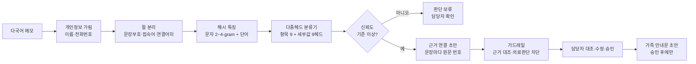

# 케어브릿지 (CareBridge)

**외국인 돌봄인력의 다국어 관찰메모를 근거가 연결된 한국어 기록 초안으로 정리하고, 기관 담당자가 원문과 대조해 승인하는 온디바이스 AI 기록지원 시제품**

2026 AI 라이프 솔루션 챌린지 출품작 · AI 라이프 아이디어 챌린지 **13번 「케어브릿지」** 구현

| 구분 | 내용 |
|---|---|
| 테스트 URL | https://humint608.github.io/carebridge/ |
| 지원 언어 | 베트남어 · 네팔어 · 인도네시아어 · 우즈베크어 · 한국어 |
| 처리 방식 | 브라우저 안에서 추론 (메모가 외부 서버로 나가지 않음) · 모델 515KB · 메모당 약 1ms |
| 블라인드 평가 | 정밀도 97.1% · 재현율 91.7% · F1 94.3 · 미확인 복약의 '복용' 오처리 0건 |
| 데이터 | 직접 작성한 합성 데이터만 사용 (실제 수급자 기록 없음) |

---

## 1. 무엇을 해결하나

요양 현장의 관찰 메모는 짧고 비정형적입니다. 한국어가 서툰 외국인 요양보호사라면 관찰한 내용을 기록 문장으로 옮기기가 더 어렵습니다. 그 결과 담당자가 다시 묻거나 기록을 새로 쓰는 일이 생깁니다. 케어브릿지는 이 과정을 다음 순서로 돕습니다.

1. 작성자가 모국어로 짧게 씁니다.
2. AI가 메모를 절 단위로 나눠 기록 항목(방문 시점·제공한 지원·식사·수면·불편감·복약·배변·정서·특이사항)으로 정리합니다.
3. 초안의 모든 문장에 **원문 근거 번호(①②③)**를 붙입니다.
4. 원문에 없는 내용은 채우지 않고 **'확인 필요'**로 남깁니다.

앱은 사이드바·상단바를 갖춘 워크스페이스 형태로, 메모 작성(모바일 앱 프레임)·대조·승인(담당자 대시보드)·기록 연습·AI 검증 결과 네 화면으로 구성됩니다.
5. 담당자가 원문과 대조해 수정하고 **승인**합니다. 가족 안내문은 승인한 뒤에만 만들 수 있습니다.

## 2. 제안자 질의답변서의 원칙과 구현 대응

| 제안자 답변(13번 질의답변서) | 구현 |
|---|---|
| "섭취량·시점이 없으면 AI가 추정하지 않고 확인할 항목으로 남깁니다" | 식사 세부값 `UNSPEC`/`LITTLE`, 시점 `UNSPEC` → 확인 필요 자동 생성 |
| "원문을 함께 보여주는 방식" | 검토 화면에서 원문과 초안을 2단으로 대조하고, 번호 호버 시 해당 원문 절 강조 |
| "가족 리포트는 담당자 승인 전 발송하지 않습니다" | 승인 전에는 가족 안내문 버튼 비활성, 승인된 값만 사용, 발송은 기관 시스템 |
| "진단·처방·건강위험 판정 … 제공하지 않습니다" | 의료 판단 표현 차단 목록(가드레일), 불편감은 '본인 표현'으로만 기록 |
| "확인하지 않은 시점·정도·복약 사실을 채우거나" 하지 않음 | 복약 `NOT_CONFIRMED`는 '미확인'으로 유지 → '잘못된 보류 해제' 지표로 0건 검증 |
| "번역은 선택 보조, 한국어 기록지원이 중심" | 직역 대신 항목별 한국어 기록 문장 생성, 한국어 축약 메모(드심·하심)도 지원 |
| "상시·강제 녹음 대신 필요한 내용을 선택적으로 메모" | 텍스트 메모 중심, 녹음 기능 없음 |
| "기관 담당자의 검토를 구분" | 작성(요양보호사)·검토(담당자)·연습(교육기관) 화면 분리, 수정 이력 기록 |
| "교육기관에서는 합성 사례로 기록을 연습" | ③ 기록 연습: 상황 카드 → 메모 작성 → 빠진 핵심 사실 피드백 |
| 검증 계획: "중요한 사실의 누락, 원문에 없는 사실 추가, 잘못된 보류 해제" | `eval/evaluate.js`가 세 지표를 그대로 측정 |
| "베트남어·네팔어·인도네시아어·우즈베크어로 합성 교육 사례" | 4개 언어 + 한국어 합성 데이터셋 구축 |

## 3. 구조



- **모델**: 공유 해시 특징(8,192차원) 위에 소프트맥스 회귀 10개 헤드(항목 1개와 세부값 9개)를 두는 멀티태스크 구조입니다. int8로 양자화해 515KB이며, 브라우저에서 바로 추론합니다.
- **생성형 문장 대신 근거 연결형 생성**: 초안 문장은 분류 결과를 정해진 한국어 문형으로 바꿔 만듭니다. 그래서 원문에 없는 사실이 끼어들 경로가 구조적으로 없습니다.
- **설명가능성**: 각 판단에 기여한 원문 단어를 노란색으로 표시합니다(헤드 가중치 기반 기여도).
- **정합성**: Python 학습 특징과 브라우저 추론 특징이 300/300 비트 단위로 일치합니다(`eval/parity.py`).
- **생성형 AI 확장(선택)**: `api/refine.js`는 외부 LLM으로 문장을 다듬는 실험용 엔드포인트입니다. LLM이 내놓은 문장도 `verifyExternalDraft()`의 근거 대조를 통과해야 채택됩니다. 시연판에서는 사용하지 않습니다.

## 4. 실행

```bash
# 그대로 열기
open docs/index.html          # 단일 HTML, 서버 불필요

# 전체 재현: 데이터 생성 → 학습 → 평가 → 웹 빌드
pip install scikit-learn numpy scipy
python data/generate.py       # 합성 데이터셋
python model/train.py         # 모델 학습 → model/carebridge_model.json
python eval/parity.py         # 특징 정합성 기준값
node eval/evaluate.js         # 평가 → eval/results.json
node eval/export_samples.js   # 샘플 결과물 → eval/SAMPLE_OUTPUTS.md
python tools/build_web.py     # web/index.html, docs/index.html
node tests/test_engine.js     # 단위 테스트
```

**배포**: GitHub Pages(Settings → Pages → `main` / `docs`)에 올리면 `https://<계정>.github.io/carebridge/`로 바로 열립니다. Vercel이나 Netlify에 `docs` 폴더를 올려도 됩니다.

## 5. 결과 (eval/results.json)

| 평가 세트 | 메모 | 정답 필드 | 정밀도 | 재현율 | F1 | 사실 추가율 | 보류 |
|---|---|---|---|---|---|---|---|
| 블라인드 자유서술 (개발 완료 후 1회 평가) | 15 | 36 | 97.1% | 91.7% | 94.3 | 2.9% | 5 |
| 현장형 자유서술 (개발 중 오류 분석용) | 25 | 67 | 100% | 89.6% | 94.5 | 0% | 10 |
| 합성 메모 · 미학습 문형 (스트레스 테스트) | 300 | 1,228 | 83.9% | 36.9% | 51.2 | 16.1% | 732 |

- **안전 지표**: 근거 없는 초안 문장 0건, 의료 판단 표현 0건, 미확인 복약의 복용 오처리 0건(전 세트)
- **개인정보 마스킹**: 재현율 5/5, 일반 단어를 잘못 가린 사례 0건(메모 40개 기준, 소규모 확인)
- **미학습 문형 절 1,182개 기준 항목 분류 정확도**: 91.2% (한국어 95.9 · 인도네시아어 93.1 · 네팔어 90.3 · 우즈베크어 89.4 · 베트남어 87.6)

> 정직한 해석: 스트레스 테스트는 학습에 쓰지 않은 문장 틀로만 만든 가장 어려운 조건입니다. 이 조건에서 세부값 재현율은 낮습니다. 다만 확신이 낮은 절은 추정하지 않고 보류로 넘기므로 정밀도는 유지됩니다. 문형 다양성은 기관 실증 데이터로 보강해야 할 과제입니다. 자유서술 세트는 규모가 작아(15~25건) 신뢰구간이 넓습니다.

## 6. 데이터

`docs/DATASET.md` 참조. 요약은 다음과 같습니다.
- 학습 절 5,624개: 5개 언어 템플릿, 핵심표현 사전, 증강(베트남어 성조 제거, 한국어 축약체, 소문자)으로 구성
- 미학습 문형 검증 절 1,182개, 합성 메모 300건, 자유서술 25건, 블라인드 15건

## 7. 한계

- 실제 현장 메모로 검증하지 않았습니다. 수치는 모두 합성 데이터 기준입니다.
- 절 분리는 규칙 기반이라 한 문장에 여러 사실이 섞인 긴 문장에 약합니다.
- 신체 부위·지원 유형은 정해진 범주 안에서만 인식합니다.
- 실사용 전에는 개인정보 처리 근거, 참여 동의, 접근 권한, 보관 기간을 기관과 확정해야 합니다.

## 8. 권리

이 결과물은 AI 라이프 아이디어 챌린지 수상 후보작(13번 케어브릿지)을 기반으로 합니다. 공고문에 따라 지식재산권은 아이디어 제안자와 솔루션 개발자가 50:50으로 공동 소유하는 것이 원칙이며, 별도 오픈소스 라이선스를 부여하지 않습니다.

```
carebridge/
├─ data/      templates.py · generate.py · *.jsonl · freetext_test.json · blind_test.json
├─ model/     features.py · train.py · carebridge_model.json
├─ web/       engine.js (추론 엔진) · app.template.html · index.html
├─ eval/      evaluate.js · parity.py · export_samples.js · results.json · SAMPLE_OUTPUTS.md
├─ api/       refine.js (선택: 생성형 AI 문장 다듬기, 근거 검증 필수)
├─ tests/     test_engine.js
├─ tools/     build_web.py
└─ docs/      index.html (GitHub Pages) · DATASET.md
```
